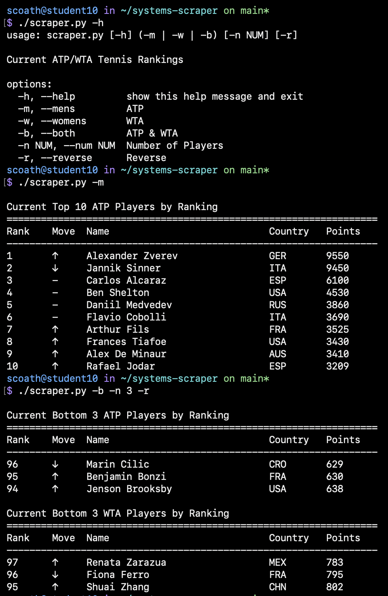

> ATP/WTA Tennis Tour Rankings

This program uses [Live Tennis API](https://livetennisapi.com/) to display up-to-date ranking information for the ATP and WTA Tours

## Installation
```Python
  chmod +x scraper.py
  ./scraper.py [-h] (-m | -w | -b) [-n NUM] [-r]
```

## Flags

| Flag | Description | Default
| :--- | :--- | :--- |
| **`-h` / `--help`** | Help | |
| **`-m` / `--mens`** | ATP rankings only | |
| **`-w` / `--womens`** | WTA rankings only | |
| **`-b` / `--both`** | Both ATP & WTA rankings | |
| **`-n NUM` / `--num NUM`** | Top NUM players | 10 |
| **`-r` / `--reverse`** | Sort in reverse order | False |

---

## Examples
  View the top 15 ATP men's players:
  ``` Bash
    ./scraper.py -m -n 15
  ```

  View the bottom 20 WTA women's players in reverse order:
  ```Bash
    ./scraper.py -w -n 20 -r
  ```

  Display both the top 5 players ATP men's and WTA women's players:
  ```Bash
    ./scraper.py -b -n 5
  ```

## Output


## Functional Programming
This scraper uses ```filter()```, ```map()```, and ```sorted()```  with helper functions and lambda expressions to allow for functional programming. For example, the following lines filter/sort the data by calling the helper function ```is_valid_singles_player()``` on all of the data and then sorting that filtered data based on ```p['ranking']```.
```Python
filtered = filter(lambda p: is_valid_singles_player(p, tour), data)
sorted_players = sorted(filtered, key=lambda p: p['ranking'])
```
Additionally, ```map()``` is used to apply the function ```fetch_tour_data()``` across a list of tours (e.g. ```['atp', 'wta']```) concurrently.
```Python 
  tour_data = thread.map(fetch_tour_data, tours)
```

## Concurrency
In addition to the concurrency provided by functional programming such as ```map()``` above, ThreadPoolExecutor from concurrent.futures was also used.
```Python with ThreadPoolExecutor(max_workers=len(tours)) as thread:
    tour_data = thread.map(fetch_tour_data, tours)
```
This allows for the API requests for each tour to be made concurrently rather than waiting for one after the other, thus increasing speed and improving performance when using multiple threads as opposed to one.
